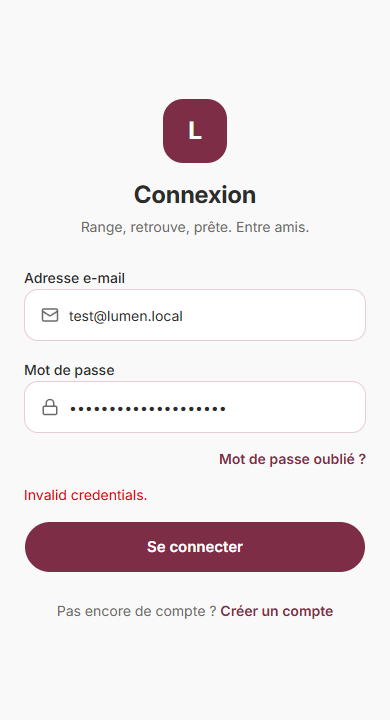
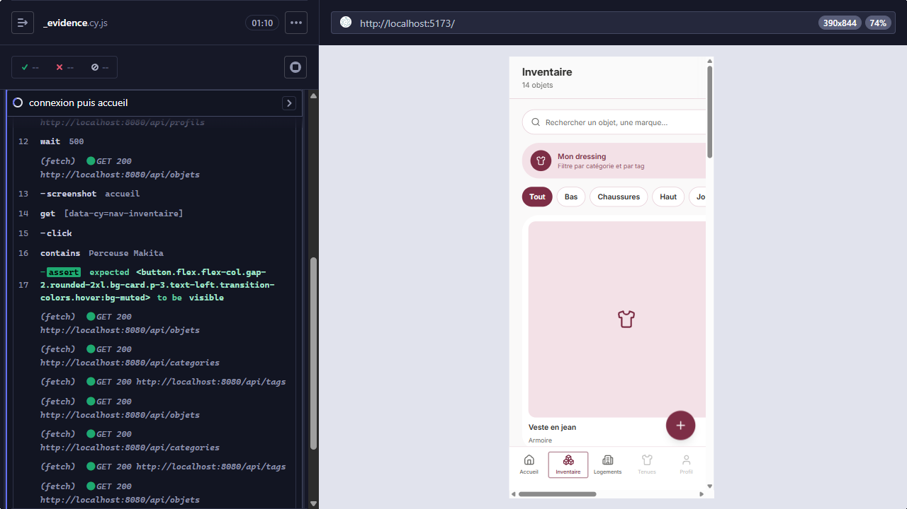

# Synthèse CI — Lumen

> Attestation du fonctionnement de la campagne de tests (séance 16-21) et de l'analyse statique (séance 15), avec sorties réelles et captures d'écran. Mis à jour le 15/10/2026, branche `feature/test`. Choix et justifications détaillés : [`coverage.md`](coverage.md) pour les tests, [`audit.md`](audit.md) pour la qualité de code.
>
> Note sur les "captures d'écran" : cette session tourne en ligne de commande (pas d'environnement graphique pour PHPStan/PHPUnit/les linters) — les preuves pour ces outils sont donc des transcriptions fidèles de la sortie terminal, copiées-collées sans modification. Les captures Cypress, elles, sont de vraies images PNG générées par le navigateur piloté (`cypress/screenshots`, copiées dans `docs/ci-screenshots/`).

---

## 1. Analyse statique (séance 15 — rappel, détails dans `audit.md`)

### PHPStan niveau 6

```
docker compose exec php vendor/bin/phpstan analyse src --level 6 --no-progress

 [OK] No errors
```

### Linter Symfony

```
$ docker compose exec php php bin/console lint:yaml config
 [OK] All 17 YAML files contain valid syntax.

$ docker compose exec php php bin/console lint:twig templates
 [OK] All 1 Twig files contain valid syntax.

$ docker compose exec php php bin/console lint:container
 [OK] The container was linted successfully: all services are injected with
      values that are compatible with their type declarations.
```

### Composer audit

```
$ docker compose exec php composer audit
No security vulnerability advisories found.
```

### oxlint (frontend)

```
$ docker compose exec frontend npx oxlint src
Found 5 warnings and 0 errors.
Finished in 169ms on 45 files with 104 rules using 16 threads.
```

(5 avertissements connus et acceptés, détaillés dans `audit.md` — fichiers générés par shadcn et un pattern `setState` volontaire.)

---

## 2. Campagne PHPUnit (unitaire + intégration + fonctionnel)

Base de test dédiée préparée au préalable, avec ses propres fixtures (`TestFixtures`, groupe Doctrine `test`, distinctes de `AppFixtures` utilisées en dev) :

```
$ make test-db-fixtures
[notice] Migrating up to DoctrineMigrations\Version20261013122545
 [OK] Successfully migrated to version: DoctrineMigrations\Version20261013122545
   > purging database
   > loading App\DataFixtures\TestFixtures
```

Campagne complète :

```
$ docker compose exec -e APP_ENV=test php vendor/bin/phpunit --testdox

Authentification Controller (App\Tests\Functional\AuthentificationController)
 ✔ Connexion reussie renvoie un token
 ✔ Mot de passe incorrect est refuse
 ✔ Route protegee sans token renvoie 401
 ✔ Route protegee avec token valide fonctionne

Blocage Repository (App\Tests\Integration\BlocageRepository)
 ✔ Camille a bloque lilou

Objet (App\Tests\Unit\Entity\Objet)
 ✔ Objet rattache a une piece est valide
 ✔ Objet rattache a un conteneur est valide
 ✔ Deplacer vers piece libere le conteneur
 ✔ Deplacer vers conteneur libere la piece
 ✔ Statut par defaut est disponible
 ✔ Emplacement avec les deux est invalide
 ✔ Emplacement sans aucun est invalide

Objet Controller (App\Tests\Functional\ObjetController)
 ✔ Creation avec piece et conteneur est refusee
 ✔ Creation sans emplacement est refusee
 ✔ Creation valide renvoie 201
 ✔ Type invalide est refuse

Objet Repository (App\Tests\Integration\ObjetRepository)
 ✔ Objets de camille sont tous rattaches au bon profil
 ✔ Perceuse existe et est rangee dans l armoire
 ✔ Velo enfant a une validation en attente liee

Partage (App\Tests\Unit\Entity\Partage)
 ✔ N est pas revoque par defaut
 ✔ Revoquer le rend irrevocablement revoque
 ✔ A un token unique a la creation

Partage Repository (App\Tests\Integration\PartageRepository)
 ✔ Partage de camille a un token et n est pas revoque
 ✔ Partage a le commentaire de lilou

Pret (App\Tests\Unit\Entity\Pret)
 ✔ Pret est actif a la creation
 ✔ Cloturer rend le pret inactif
 ✔ Cloturer est idempotent sur la date

Pret Repository (App\Tests\Integration\PretRepository)
 ✔ Pret de la perceuse est actif et en retard
 ✔ Pret de la veste est cloture et inactif

Profil (App\Tests\Unit\Entity\Profil)
 ✔ N est pas mineur par defaut
 ✔ Peut etre marque mineur

Refus Tenue (App\Tests\Unit\Entity\RefusTenue)
 ✔ Refus ciblant une categorie est valide
 ✔ Refus ciblant un objet est valide
 ✔ Refus ciblant les deux est invalide

Refus Tenue Repository (App\Tests\Integration\RefusTenueRepository)
 ✔ Refus de camille cible la categorie outils

Registration Controller (App\Tests\Functional\RegistrationController)
 ✔ Inscription reussie
 ✔ Champs manquants renvoie 400
 ✔ Mot de passe trop court renvoie 400
 ✔ Email deja utilise renvoie 409

Tenue Valise Repository (App\Tests\Integration\TenueValiseRepository)
 ✔ Tenue du jour contient la veste
 ✔ Valise weekend contient la veste

Transaction Repository (App\Tests\Integration\TransactionRepository)
 ✔ Transaction du plaid est en cours

User Repository (App\Tests\Integration\UserRepository)
 ✔ Find user by email
 ✔ User inconnu renvoie null

Validation (App\Tests\Unit\Entity\Validation)
 ✔ Payload null par defaut
 ✔ Payload fait un aller retour fidele
 ✔ Payload vide est traite comme absent
 ✔ Statut et decision par defaut
 ✔ Decider met a jour statut et date

OK (49 tests, 135 assertions)
```

**49/49 tests, 0 échec** (23 unitaires + 14 intégration + 12 fonctionnels). Justification du choix de chaque test et de la couverture obtenue : `coverage.md`.

---

## 3. Campagne e2e Cypress (locale)

Pile applicative démarrée (`make up`), exécution headless contre le vrai front (Vite, port 5173) et le vrai backend (nginx, port 8080) :

```
$ cd frontend && npx cypress run

Running:  add-objet.cy.js
  Ajout manuel d'un objet
    ✔ crée un objet rattaché à une pièce existante et l'affiche dans l'inventaire

Running:  dressing.cy.js
  Dressing (filtrage)
    ✔ affiche tous les vêtements sans filtre
    ✔ filtre par catégorie "Vestes" : ne garde que la Veste en jean
    ✔ filtre par le tag #Décontracté : exclut la Veste en jean (sans tag)
    ✔ revenir à "Tout" réaffiche tous les vêtements

Running:  login.cy.js
  Connexion
    ✔ refuse un mauvais mot de passe avec un message explicite
    ✔ connecte avec les identifiants de démo et affiche l'accueil

Running:  logout.cy.js
  Déconnexion
    ✔ déconnecte et renvoie à l'écran de connexion

Running:  navigation.cy.js
  Navigation principale
    ✔ mène à l'inventaire et affiche la liste d'objets
    ✔ mène aux logements
    ✔ revient à l'accueil

Running:  pret.cy.js
  Cycle de vie d'un prêt
    ✔ crée un prêt, le voit en cours, puis le clôture

Running:  register.cy.js
  Inscription
    ✔ crée un compte et renvoie vers la connexion
    ✔ refuse un email déjà utilisé

✔ All specs passed!                        01:39       14       14        -        -        -
```

**14/14 tests e2e, 0 échec** (7 specs, un par parcours métier principal). Détail de chaque parcours et de deux bugs trouvés en les écrivant (déconnexion impossible sur mobile, test de prêt fragile face à un nom d'objet fixe) : `coverage.md`.

### Fiabilité de la campagne complète

Un premier lancement groupé des 7 specs révélait des échecs intermittents (API qui ne répondait plus à temps pendant `add-objet.cy.js`/`pret.cy.js`) : le pool `php-fpm` par défaut (`pm.max_children = 5`) sature quand plusieurs scénarios Cypress enchaînent chacun 5 à 8 requêtes API en parallèle. Corrigé en portant `pm.max_children` à 20 pour le dev (`backend/docker/php/www.conf`) — la sortie ci-dessus est la campagne complète, relancée plusieurs fois de suite après ce correctif, systématiquement verte.

### Captures

**Connexion refusée (mauvais mot de passe)** — le formulaire reste affiché avec un message d'erreur explicite, pas de redirection silencieuse :



**Connexion réussie → accueil** (gabarit mobile, barre de navigation basse visible) :


**Navigation vers l'inventaire** (objets des fixtures affichés, filtres par catégorie) :



---

## Résumé

| Campagne | Résultat |
|---|---|
| PHPStan niveau 6 | 0 erreur |
| Linter Symfony (yaml/twig/container) | OK |
| Composer audit | 0 vulnérabilité |
| oxlint (frontend) | 0 erreur, 5 avertissements connus |
| PHPUnit (unitaire + intégration + fonctionnel) | 49/49 |
| Cypress (e2e, local, 7 specs) | 14/14 |

Tout est vert. Intégration de la campagne Cypress en CI/CD : prévue pour une prochaine séance (avec Thomas), cf. `coverage.md`.
